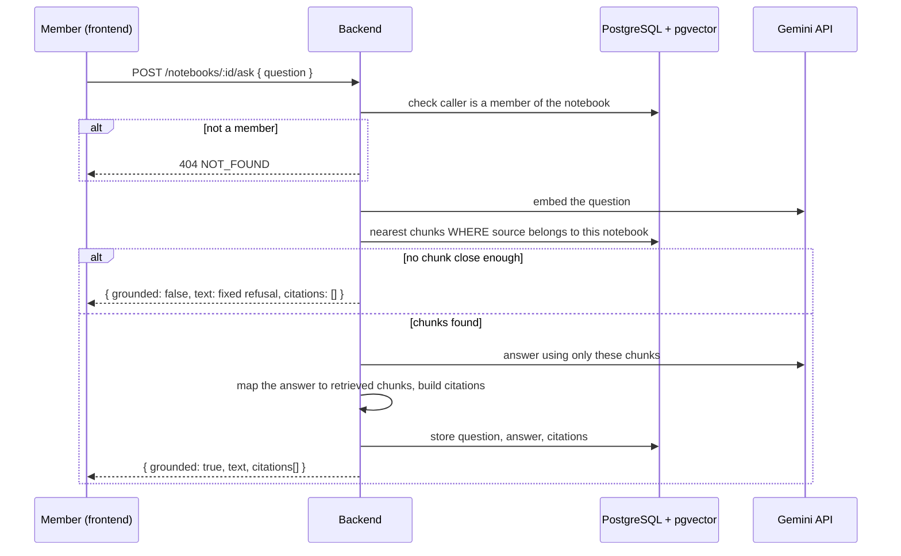

# Flow: ask a question with citations

Status: implemented in the frontend and backend contract; live browser/API verification is pending because the local backend is unavailable.

Rules: the notebook filter is inside the retrieval query; a citation must reference a chunk that was actually retrieved; an answer with no valid citation is converted to `grounded: false`.

The frontend renders citations as source/page controls. Selecting one opens the source page dialog using `GET /notebooks/:id/sources/:sourceId/pages/:page`; loading, request failure, and ungrounded answers remain visible as text states.
