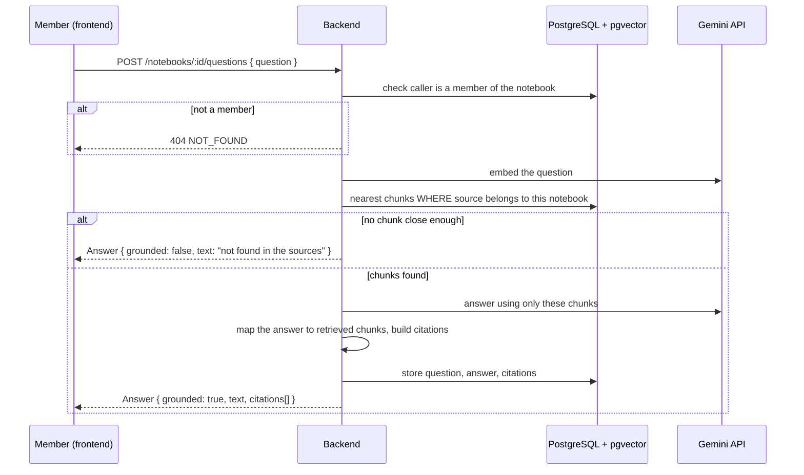

# Flow: ask a question with citations

Status: planned (nothing here is implemented yet).

Rules: the notebook filter is inside the retrieval query; a citation must reference a chunk that was actually retrieved; an answer with no valid citation is converted to `grounded: false`.
