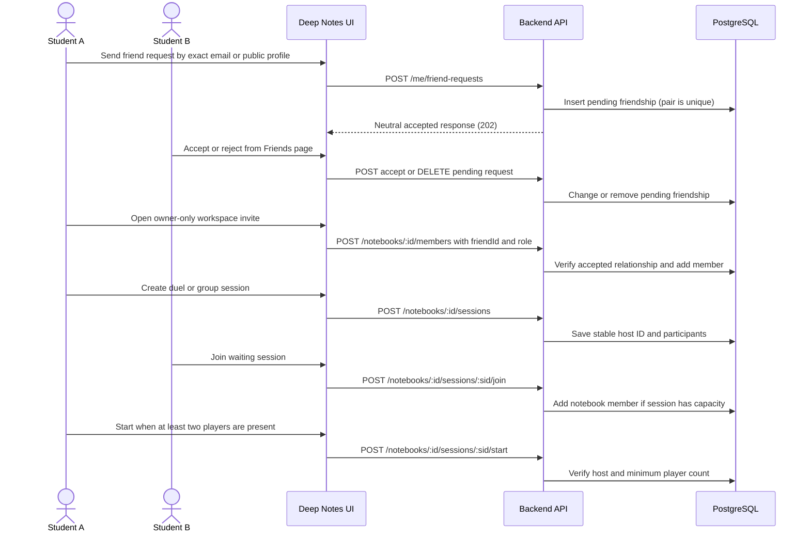

# Friends, workspace invitations, and game sessions

Friend relationships and game participation are account-backed. An email is used only to find a registered account; friend lists and request responses expose a public name and optional course, never an email.

## Rules

- Unknown emails and valid registered emails receive the same friend-request acknowledgement. Requests are rate limited per account.
- A friend must accept before an owner can add that account by `friendId`. The owner can also add a registered exact email directly.
- Workspace membership grants game access. The session URL by itself does not grant access to a non-member.
- Duel and group sessions stay in the lobby until the session host starts them. The API requires at least two participants and caps a duel at two and a group at twelve.
- Solo sessions start immediately. Every session response includes `hostId`; the frontend does not infer host identity from live score order.
- The UI polls waiting/running sessions; real-time delivery uses polling until a websocket contract exists.
