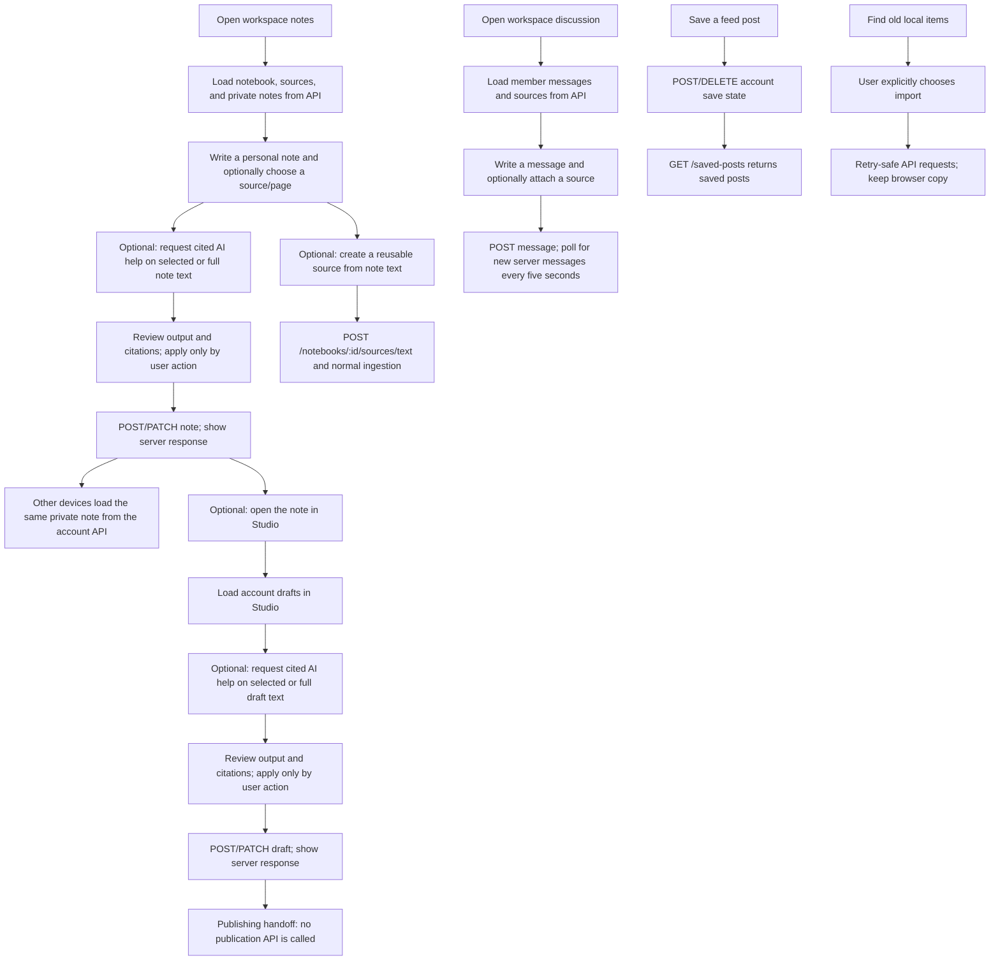

# Flow: server-backed frontend inputs and remaining handoffs

Status: implemented locally; the shared demo deployment is pending.

Notes, discussions, drafts, and saved posts now use authenticated APIs. Notes remain private to their author; discussion is shared with notebook members. Old browser items are not uploaded automatically, and their local copies are preserved after explicit import. AI assistance sends selected/current editor text only after the user chooses an action; it returns citations but does not save the text or result. Turning a note into a workspace source is also an explicit action.

Publication, recovery email, notifications, and live classroom presence remain handoffs in [API_HANDOFF.md](../frontend/API_HANDOFF.md). The new note, discussion, draft, and saved-post endpoints are documented in [API_CONTRACT.md](../API_CONTRACT.md); the shared demo server still needs the migration and backend deployment.
