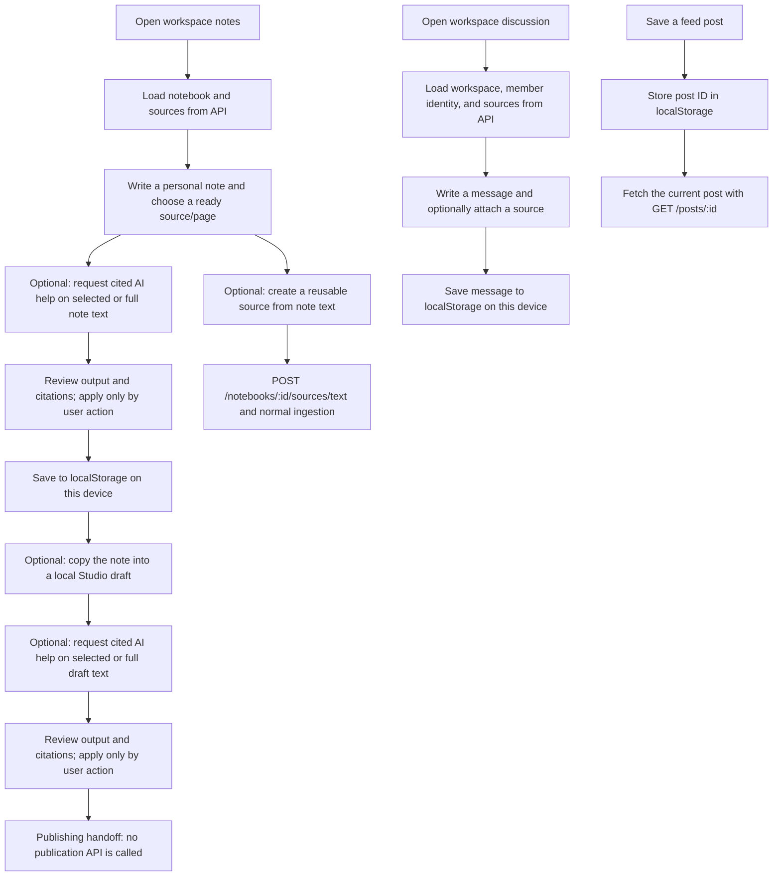

# Flow: local-only frontend work and backend handoffs

Status: implemented in the browser; local persistence is limited to the current device and browser profile.

The notes, discussion messages, saved-post IDs, and Studio drafts are not synchronized with another browser or workspace member. The UI states this before a user saves locally. AI assistance sends selected/current editor text only after the user chooses an action; it returns citations but does not save the text or result. Turning a note into a workspace source is also an explicit action. Saved posts are retrieved through the existing `GET /posts/:id`; unavailable or deleted posts are omitted from the local saved list.

The backend handoff is recorded in [API_HANDOFF.md](../frontend/API_HANDOFF.md). Notes, discussion, and drafts remain local; the documented AI assist and source-ingestion endpoints are called only for the user's explicit actions.
