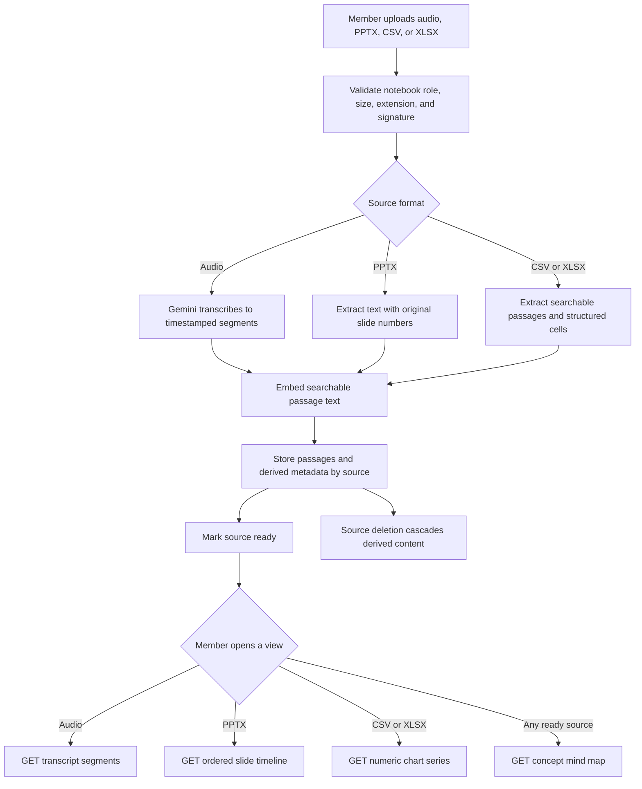

# Audio and structured source visualizations

Original audio is not saved. Audio transcription requires the backend Gemini configuration. Spreadsheet charts use stored extracted values without AI generation, while PPTX timeline entries retain source slide numbers. Every read is notebook-member scoped.
