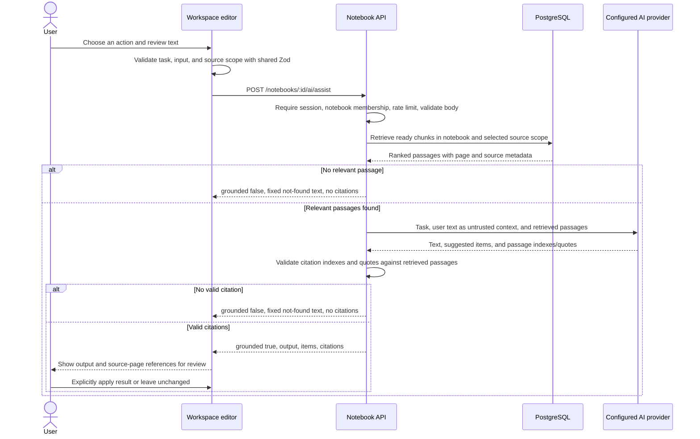

# Workspace AI assistance

The ask, companion, quiz, and game tools reuse one per-notebook source scope. Notes, discussion drafts, and Studio send their current text only when the user chooses an AI action. AI assistance itself is not stored.

Notes, discussion messages, and Studio drafts persist through their authenticated APIs. A user can still explicitly submit a note through `POST /notebooks/:id/sources/text`; source-role checks and normal ingestion then apply.
